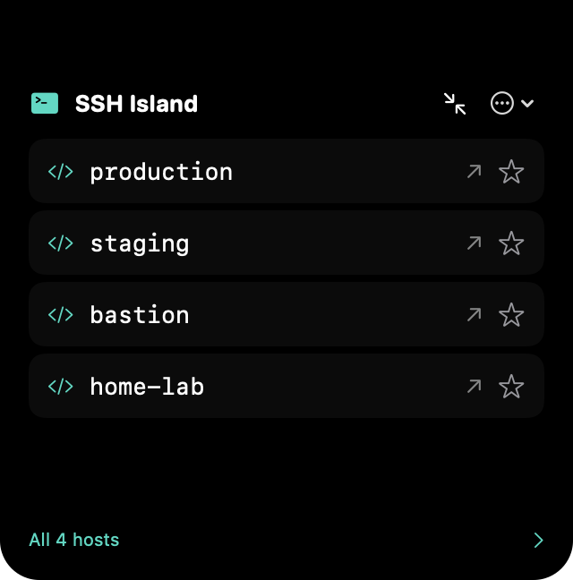
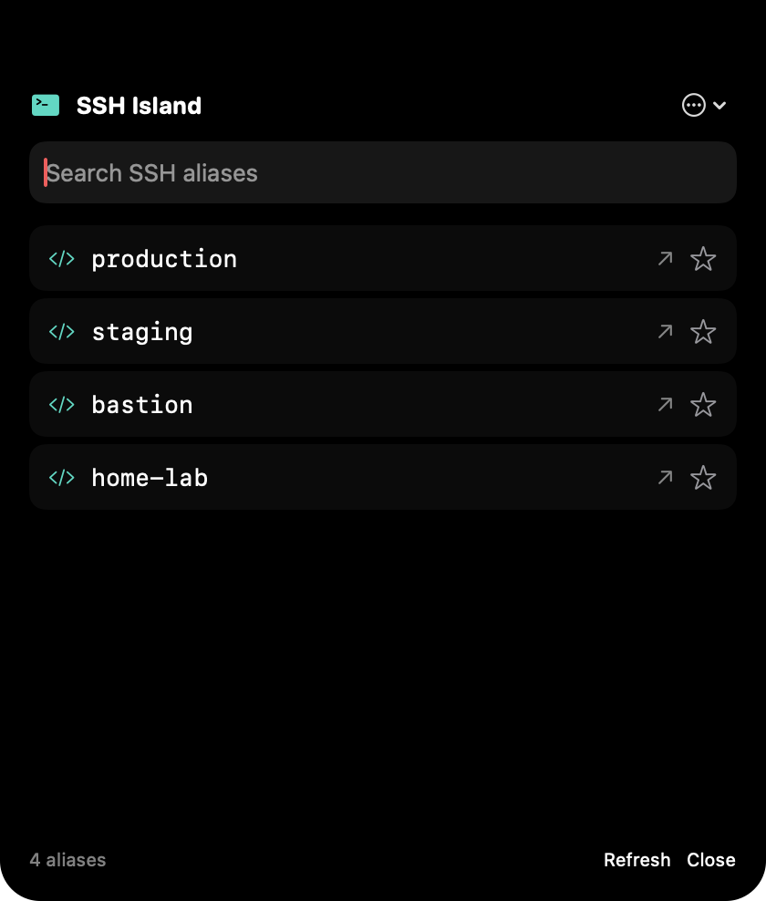

# Validation — 2026-10-29

## GitHub packaging validation

The first hosted [Build and release run](https://github.com/eugenfaust/ssh-island/actions/runs/40908636957) passed on the `xcode-27` ARM64 runner (macOS 27.0.1, Apple Swift 6.4): 16 tests with zero failures, release app build, signature/plist validation, DMG verification and SHA-256 verification. The DMG and checksum were uploaded as an Actions artifact. The artifact upload action was then updated to v7.0.2 to remove GitHub's Node.js 20 deprecation warning.

The [v0.1.0 release run](https://github.com/eugenfaust/ssh-island/actions/runs/40909114456) also passed, including publishing the [release and both assets](https://github.com/eugenfaust/ssh-island/releases/tag/v0.1.0). An unauthenticated download of the published DMG/checksum passed SHA-256 verification. The download action was subsequently updated to v8.0.2 (same name/path inputs, Node.js 24 runtime) for future releases after the publishing job exposed its Node.js 20 deprecation warning. The published v0.1.0 assets remain unchanged.

Local release checks also passed: `scripts/package.sh`, `codesign --verify --strict`, `hdiutil verify` and `shasum -a 256 -c`. Mounting the DMG read-only confirmed the executable is arm64, the app version is 0.1.0 and the Applications link points to `/Applications`. Workflow syntax/shell checks passed with `actionlint` (only the documented preview runner label was excluded from its outdated built-in label list). These checks do not replace interactive installation/Automation/display checks or provide Developer ID signing/notarization.

## Application validation

Environment: Apple Silicon, macOS 27.0.1 (26A434), Swift 6.3.2, Apple Command Line Tools macOS SDK 26.5; Mach-O deployment target verified as 27.0. No macOS-27-only APIs are required by the implementation. Full Xcode is not installed. One built-in notched display was detected by the app's public-API geometry check.

Executed successfully:

- `./scripts/test.sh`: 16 tests, zero failures. Alias ordering, comments, wildcards, duplicates, multiple/quoted aliases, missing/unreadable files, Includes (quoted/tilde/nested/glob/relative-base/cyclic/limited), Match and command-substitution nonexecution, rejection of special device files, shell argument round-trips, structured Apple Event parameters, unsafe alias rejection, recovery guidance when no Automation entry exists, global-coordinate geometry/fallback, isolated preferences and watcher replacement/new-glob/deletion integration.
- `./scripts/build.sh`: release arm64 app bundle, macOS 27 minimum, ad hoc signed; no compiler warnings.
- `./scripts/smoke.sh`: 32 passing app integration checks. Accessory activation policy, camera-gap hover callback, expanded/key panel anchored at the display top, camera trigger reaching the physical display top, continuous panel/trigger geometry, WindowServer-confirmed overlay layers above the status bar and below pop-up menus, actual keyboard events (↓/↓/Return and Escape), search, favorites, injected terminal selection, recents, dismiss, error feedback, failed-launch recents and menu fallback. These checks send local events/callbacks, not a physical-pointer automation session.
- `./scripts/package.sh`: local-test compressed DMG produced successfully.
- `plutil -lint`: app Info.plist and distribution entitlements valid.
- `codesign --verify --strict`: valid local signature; `file`/`otool` confirm arm64 and minimum macOS 27.0. The normal app was launched with `open` and its process remained running.

The initial direct-executable Terminal test was denied (-1743); TCC logs showed that the responsible app was VS Code, not SSH Island. This test is now launched through LaunchServices (`open -n -W ... --args --terminal-smoke`). The app explicitly calls `AEDeterminePermissionToAutomateTarget(..., true)` before sending events, offers **Request Terminal access** in Settings and includes the Apple Events entitlement in local hardened-runtime signatures.

`./scripts/terminal-smoke.sh` now **passes**: Terminal executed `/usr/bin/ssh` against 127.0.0.1 port 1 with `/dev/null` configuration, no identity file/agent and a two-second timeout. The output contained the expected `Connection refused` and completion marker. No user SSH config was modified or evaluated. The permission-denial guidance no longer assumes an Automation entry already exists.

Overlay regression checks pass after raising both panels to status-bar level + 1 and overriding AppKit's menu-bar frame constraint. The actual WindowServer layers and the trigger's global top edge are asserted, rather than relying only on offscreen view captures.

Still requires interactive validation: interactive SSH authentication to a controlled host, physical pointer handoff around the notch, monitor hot-plug/rearrangement, sleep/wake, full-screen Spaces, VoiceOver and actual login launch. Login settings were not enabled during automated validation. Developer ID signing and notarization were not attempted without credentials.

Screenshots are actual app-view captures using synthetic aliases, generated by the self-test:

Collapsed-corner regression: the idle panel now spans the full camera depth plus the 8-point extension. A raster regression check verifies both corner curves start above the notch seam; a separate frame assertion verifies this is one full-height surface. Previously the 22-point corner radius was restricted to an 8-point-high view and the corner contour was truncated. `build/smoke/collapsed.png` captures the rendered idle surface.

Alias discovery regression: the live LaunchServices-launched app reproduced a root-config failure with NSCocoaErrorDomain:262. The application's FileAttributeType cast/guard incorrectly rejected a regular `config`; it was replaced with a descriptor-based `open`/`fstat` check and bounded reading. This also validates the opened inode instead of checking a path before opening it. Regression tests cover regular files, symlinks, FIFO/directory rejection, the size bound and invalid UTF-8. The live app now indexes all 15 real aliases without warnings. Root read errors remain distinct from a missing file, retry once after 250 ms and expose Retry if persistent. Injected async discovery tests cover recovery to 15 hosts, the four-row preview versus the full list, and persistent failure presentation. No actual host aliases are written to diagnostic reports or screenshots. The preview now has an explicit **All N hosts** action.

Menu-bar expansion: preview and expanded silhouettes now include the camera depth at their full width, instead of starting below the menu bar with a narrow camera neck. The view reserves that depth above its controls and ignores automatic hosting safe-area insets. Geometry tests cover the full-height frame; raster checks verify opaque black pixels at both top shoulders for preview and expanded states. This intentionally covers the central menu-bar area at the user's request. Pop-up menus remain above the overlay.

Search-height regression: reproduced in both island and fallback hosting. SwiftUI’s changing intrinsic sizing shrank the viewport for an empty search and did not grow it after clearing. Island hosting and popover-controller sizing are now explicitly owned by AppKit; the root fills that viewport and the popover size is assigned after installing its controller. Regression checks exercise 15 hosts → one match → zero matches → cleared search, asserting stable window/view dimensions, restored host count and an opaque background at the bottom of the restored viewport. Both checks failed before the fix and pass afterwards. Synthetic view captures are written as `*-empty-search.png` and `*-cleared-search.png` under `build/smoke/`.

Optional menu-bar icon: the new preference defaults to visible, applies immediately and persists in UserDefaults. Runtime tests operate on the actual NSStatusItem and verify hiding with a working island, Settings recovery through the app-reopen handler, forced visibility when the overlay is unavailable, reapplying the hidden preference when the overlay returns and showing the icon again. Preference persistence assertions cover the default and saved hidden state. Settings and Quit remain accessible through the island menu and reopened Settings window.

Duplicate Terminal window regression: replaced the normal LaunchServices open/reopen before automation permission checks with a fixed AppleScript `launch` command. SSH commands still use structured Apple Events. `./scripts/test.sh` passes all 16 tests and `./scripts/build.sh` produces the release bundle. The extended `./scripts/terminal-smoke.sh` passes from a stopped Terminal (0 → 1 windows) and a running Terminal with an existing window (1 → 2). In both cases three permission requests created no windows and the controlled localhost SSH command executed. Terminal running with all windows closed, restored sessions, and denied/revoked permission remain manual checks. No existing terminal windows were closed.
